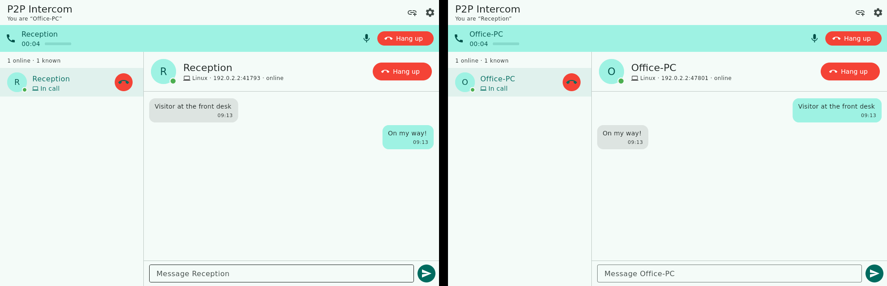
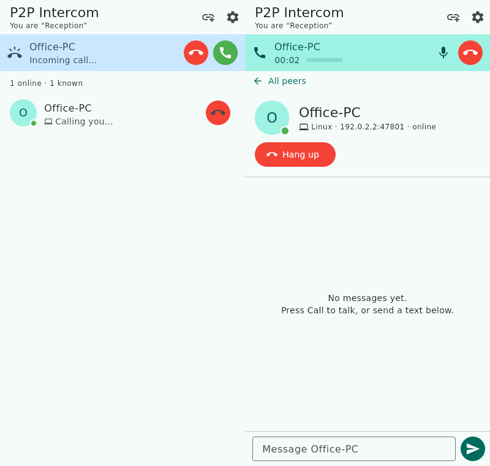

# P2P Intercom

A serverless, peer-to-peer **voice intercom over TCP/IP** for **Linux, Windows
and Android**, with a GUI that lists every intercom on the local network and
lets you switch between them with one click.





## Features

- **Zero configuration**: peers find each other automatically with UDP
  broadcast beacons. No server, no accounts.
- **Full-duplex voice calls** over a direct TCP connection: 16 kHz, 16-bit mono
  PCM (~256 kbit/s), 20 ms frames, latency capped at 250 ms.
- **Switch between peers**: the peer list shows who's online; clicking another
  peer's call button (⇄) hangs up the current call and calls the new one.
- **Ring / answer / decline / busy / missed call**. Unanswered calls time out
  after 30 s.
- **Auto-answer ("intercom mode")**: incoming calls connect straight away, like a
  door intercom.
- **Text chat** with each peer, with unread badges.
- **Mute**, a live mic level meter and a call timer. On Android you can also
  switch between loudspeaker and earpiece.
- **Add a peer by IP** for networks that block broadcast (VPNs, some
  routers or other subnets). Peers you add this way are remembered.
- **Responsive UI**: on desktop and tablets the peer list and the chosen peer
  are side by side; on phones you tap through from the list to a peer's page. The
  call bar stays on top either way.

## How it works

```
 ┌──────────── Device A ────────────┐            ┌──────────── Device B ────────────┐
 │ Flutter UI (lib/ui)              │            │                                  │
 │   │                              │  UDP 47800 │                                  │
 │ IntercomService ── Discovery ────┼─ broadcast ┼──── Discovery                    │
 │   │      │                       │   beacons  │                                  │
 │   │   PeerConnection ────────────┼─ TCP 47801 ┼──── PeerConnection               │
 │   │      (framed protocol)       │            │                                  │
 │ AudioEngine ─ FFI ─ intercom_audio (C, miniaudio)                                │
 │   PulseAudio/ALSA · WASAPI · AAudio/OpenSL ES                                    │
 └──────────────────────────────────┘            └──────────────────────────────────┘
```

| Layer | File | Notes |
|---|---|---|
| Discovery | `lib/src/discovery.dart` | JSON beacon every 2 s to `255.255.255.255` and each interface's /24 broadcast address. A peer counts as offline after 7 s without a beacon. |
| Transport | `lib/src/peer_connection.dart` | One TCP socket per peer pair, `TCP_NODELAY`. |
| Protocol | `lib/src/protocol.dart` | Each frame is `[type:1][length:4 BE][payload]`. Control frames carry JSON; audio frames carry raw PCM16LE. |
| Call logic | `lib/src/intercom_service.dart` | Peers, the single active call, chat and the audio pump. |
| Audio | `packages/intercom_audio` | Flutter FFI plugin built on [miniaudio](https://miniaud.io), with lock-free ring buffers between the native audio threads and Dart. |
| Android glue | `android/.../MainActivity.kt` | Mic permission, Wi-Fi multicast lock, `MODE_IN_COMMUNICATION` (hardware echo cancellation) and speaker routing. |

### Wire protocol

| Code | Type | Payload |
|---|---|---|
| `0x01` | HELLO | `{"id","name","platform","port","v"}` (sent by both sides when the connection opens) |
| `0x02` | CALL_REQUEST | `{"sampleRate":16000}` |
| `0x03` | CALL_ACCEPT | – |
| `0x04` | CALL_REJECT | `{"reason":"busy"\|"declined"}` |
| `0x05` | HANGUP | – |
| `0x06` | AUDIO | PCM16 little-endian, mono |
| `0x07` | TEXT | `{"text": "..."}` |
| `0x08/0x09` | PING / PONG | – |

## Building

You need the [Flutter SDK](https://docs.flutter.dev/get-started/install)
(stable, 3.32 or newer). The audio library is vendored, so it needs no extra
packages.

```bash
flutter pub get
flutter test                      # unit + end-to-end (localhost TCP) tests
```

**Linux** (needs `clang cmake ninja-build pkg-config libgtk-3-dev`):

```bash
flutter build linux --release
./build/linux/x64/release/bundle/p2p_intercom
```

**Windows** (needs Visual Studio 2022 with "Desktop development with C++"):

```powershell
flutter build windows --release
build\windows\x64\runner\Release\p2p_intercom.exe
```

**Android** (needs the Android SDK with the NDK; minSdk 24):

```bash
flutter build apk --release --split-per-abi
adb install build/app/outputs/flutter-apk/app-arm64-v8a-release.apk
```

Every push runs `.github/workflows/build.yml`, which tests the code and uploads
Linux, Windows and Android builds as artifacts.

## Usage

1. Start the app on two or more devices on the **same LAN or Wi-Fi**.
2. They show up in each other's peer list within about 2 seconds. A green dot
   means online.
3. Click a peer to open it, then press **Call**. The other side rings and can
   **Answer** or **Decline**. Turn on *Settings → Auto-answer* to get
   door-intercom behaviour.
4. To talk to someone else, press the ⇄ button next to them (or **Switch call
   here** on their page). The current call ends and the new one starts.
5. If a peer doesn't appear, use **Add peer by IP** (🔗 icon) and enter the IP
   address shown in that device's *Settings*.

Set `P2P_INTERCOM_PROFILE=<name>` to run several separate instances on the same
computer, for example while testing.

### Firewall and network notes

- Allow **TCP 47801** (calls and chat) and **UDP 47800** (discovery). Windows
  asks the first time you run the app. Allow *Private networks*.
- Guest Wi-Fi with "client isolation" blocks traffic between devices. Use a
  normal network.
- If port 47801 is already taken, the app uses a random port and advertises it
  in its beacons. Discovery still works, but adding that instance by IP needs
  `host:port`.

### Audio notes

- Android uses the platform's voice-communication path, which includes
  hardware echo cancellation.
- Desktop builds have **no echo cancellation**. Use headphones, or mute when
  you're not talking, to avoid feedback.
- Audio is not encrypted or compressed. It is meant for trusted local networks.

## Project layout

```
lib/
  main.dart                 app entry, theme
  src/                      networking, protocol, call logic (no UI)
  ui/                       home page, peer list, peer panel, call bar
packages/intercom_audio/    FFI audio plugin (C + miniaudio)
android/ linux/ windows/    platform runners
test/                       protocol + multi-node integration tests
```

## License

MIT. miniaudio is public domain / MIT-0.
