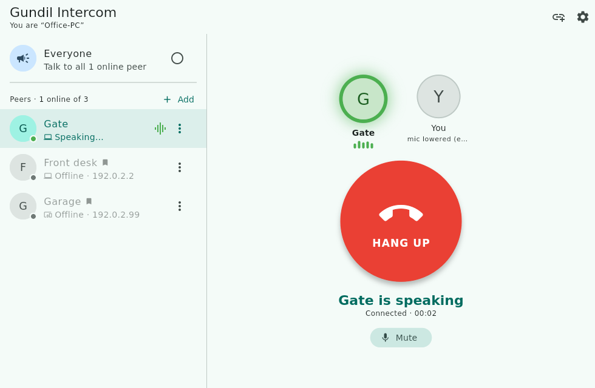

# Gundil Intercom

A serverless, peer-to-peer **two-way audio intercom over TCP/IP** for
**Android, Windows, Linux, Orange Pi PC and Raspberry Pi**. Pick who to talk
to and press **Connect**: both sides talk and listen at the same time, like a
phone call, until one of you hangs up. Intercoms answer automatically, like a
door station; you can turn that off to ring and accept instead. During a
call, Android and Windows can also turn on their **camera** for video.



| Platform | Runs | Echo handling |
|---|---|---|
| Android (phone/tablet) | App | Phone's hardware echo canceller (call audio mode) |
| Windows 10/11 | App + installer | Software echo suppression |
| Linux PC (x64) | App | Software echo suppression |
| Raspberry Pi 4/5, 64-bit OS | App (`linux-arm64`) **or** headless node | Software echo suppression |
| Orange Pi PC/One/Zero, Raspberry Pi 2/3 or 32-bit OS | Headless node | Software echo suppression |

## Features

- **Two-way audio (full duplex)**: press **Connect** and talk naturally, both
  directions at once, until either side presses **Hang up**.
- **Auto-answer**: an incoming connection opens at once, with a chime, like an
  intercom. Turn off *Answer automatically* in Settings to ring with
  **Accept / Decline** instead. While ringing, your microphone stays off.
- **Talk to one peer or to Everyone**: *Everyone* connects to all online
  intercoms at once. You hear all of them mixed together and they all hear you.
- **Switch with one tap**: pick another peer and press Connect. The current
  line is hung up and the new one opens.
- **See who is speaking**: each participant (and *You*) has a card that
  lights up with a green ring and level bars while they talk, the status
  reads "*Gate is speaking*", and the peer list shows *Speaking…*. With
  *Everyone* you can tell the voices apart.
- **Know when someone connects**: an in-app "*Gate connected*" message. If
  the window is hidden, Windows shows a notification from the tray icon and
  the tray tooltip names who's speaking. On Android, the background-mode
  notification shows "*Connected with Gate*" or "*Gate wants to talk*". The
  Orange Pi / Raspberry Pi node logs "*🔊 Gate is speaking*".
- **Video calls (Android and Windows)**: during a call, press **Camera on**
  to send your camera. It never turns on by itself: every call starts with
  the camera off. On Android, the **switch** button flips between the front
  and back camera. On Windows, the camera menu lists the built-in webcam and
  any USB webcam, so you can choose one. The other side sees your video
  (the Linux and Raspberry Pi desktop apps show video too; the headless node
  ignores it). With *Everyone* it works like the audio: the caller sees
  every member, and the members see the caller. Your own picture shows as a small self-view. Video
  adapts to the network: pictures are dropped rather than delaying the
  audio. On Android the camera pauses while the app is in the background.
- **Mute** and a call timer.
- **Android audio output picker**: during a call, tap the output button to
  switch between **Speaker**, **Phone (earpiece)**, a **Bluetooth headset**
  (listed by name; its microphone is used too) and a **wired headset**. Calls
  start on Bluetooth if one is connected, else a wired headset, else the
  speaker. Connecting a headset mid-call switches to it, and if it
  disconnects the audio falls back automatically.
- **Echo handling**: Android uses the phone's echo canceller. PCs and boards
  use software echo suppression, which lowers your mic while the other side
  talks so they don't hear themselves. Turn it off with a headset.
- **Zero configuration**: intercoms on the same LAN/Wi-Fi find each other
  automatically with UDP broadcast. No server and no accounts.
- **Reliable**: a member that stops responding (crash, Wi-Fi lost) is dropped
  after 8 s. Unanswered calls time out after 30 s. Calling each other at the
  same moment just connects.
- **Starts with Windows (or Linux login)**: optional. On Windows it starts
  in the system tray at sign-in, so the intercom is always ready to receive.
- **Windows system tray**: minimize or close the window and it keeps running
  in the notification area. Click the tray icon to open it, right-click it
  for *Open* / *Exit*. Hover over it to see who you're connected with.
- **Saved peers**: add a peer by IP (or keep a discovered one) and it stays in
  the list across restarts, greyed out while offline. The app keeps retrying
  in the background, so a saved peer comes online automatically. This also
  works on networks that block broadcast.
- **Edit peers**: every peer has a ⋮ menu (or long-press) to rename it, change
  its IP/port, keep it in the list, or remove it. If a saved device gets a new
  IP, the saved address updates itself once the device is seen again.

## Orange Pi PC / Raspberry Pi (headless node)

Small Linux boards with a microphone and a speaker can be intercom stations
without a screen. The **headless node** joins the same intercom network,
**answers incoming connections automatically** (two-way, like a door
station), connects to a chosen intercom with a **GPIO button** (or USB
key/foot pedal), drives an optional LED, and starts on boot.

- Orange Pi PC (32-bit ARM, built-in mic + speaker jack):
  `gundil-intercom-node-linux-arm.tar.gz`
- Raspberry Pi (USB mic or USB sound card; jack, USB or HDMI speaker): `…-arm`
  for 32-bit Raspberry Pi OS, `…-arm64` for 64-bit

Setup, wiring, pin tables and audio troubleshooting are in
**[node/README.md](node/README.md)**.

```bash
tool/build_node.sh arm      # or arm64 / x64  -> build/node/*.tar.gz
```

## How it works

```
 ┌──────────── Device A ────────────┐            ┌──────────── Device B ────────────┐
 │ Flutter UI (lib/ui)              │            │                                  │
 │   │                              │  UDP 47800 │                                  │
 │ IntercomService ── Discovery ────┼─ broadcast ┼──── Discovery                    │
 │   │      │                       │   beacons  │                                  │
 │   │   PeerConnection ────────────┼─ TCP 47801 ┼──── PeerConnection               │
 │   │      (framed protocol)       │            │                                  │
 │ AudioEngine ─ FFI ─ intercom_audio (C, miniaudio)                                │
 │   PulseAudio/ALSA · WASAPI · AAudio/OpenSL ES                                    │
 └──────────────────────────────────┘            └──────────────────────────────────┘
```

| Layer | File | Notes |
|---|---|---|
| Discovery | `packages/intercom_core/lib/src/discovery.dart` | JSON beacon every 2 s to `255.255.255.255` and each interface's /24 broadcast address. A peer counts as offline after 7 s without a beacon. |
| Transport | `packages/intercom_core/lib/src/peer_connection.dart` | One persistent TCP socket per peer pair, `TCP_NODELAY`. |
| Protocol | `packages/intercom_core/lib/src/protocol.dart` | Each frame is `[type:1][length:4 BE][payload]`. |
| Conversation logic | `packages/intercom_core/lib/src/intercom_core.dart` | Peers, connect / accept / hang up, liveness, audio pump. Pure Dart, shared by the app and the headless node. |
| Mixer | `packages/intercom_core/lib/src/mixer.dart` | Per-peer jitter buffers (60 ms prebuffer, 300 ms cap) mixed for the speaker; about 100 ms queued in the device. |
| Echo suppression | `packages/intercom_core/lib/src/echo_suppressor.dart` | Lowers the mic by about 22 dB while the far end talks, unless you speak clearly louder (barge-in). |
| Audio I/O | `packages/intercom_audio` | Flutter FFI plugin built on [miniaudio](https://miniaud.io), with lock-free ring buffers between the native audio threads and Dart. On Android it uses the voice-communication path, which has the echo canceller. |
| Android glue | `android/.../GundilApp.kt` etc. | Mic permission, Wi-Fi multicast lock, call audio mode and speaker routing, background service. |

### Wire protocol (v3)

| Code | Type | Payload |
|---|---|---|
| `0x01` | HELLO | `{"id","name","platform","port","v","video"}` (sent by both sides when the connection opens; `video` is true for apps that can show video) |
| `0x02` | OPEN | `{"sampleRate":16000,"group":bool}` (asks to open a two-way line) |
| `0x05` | ACCEPT | – (sent automatically when auto-answer is on) |
| `0x06` | REJECT | `{"reason":"busy"\|"declined"\|"timeout"}` |
| `0x03` | CLOSE | – (hang up) |
| `0x04` | AUDIO | PCM16 little-endian, mono, 16 kHz, about every 20 ms, **both directions** while connected |
| `0x08/0x09` | PING / PONG | – (every second while connected; 8 s of silence = lost) |
| `0x0A` | VIDEO | `[rotation:1][JPEG]`, about 640×480 at up to 15 fps while the camera is on; just the rotation byte = camera off. Only sent to peers whose HELLO has `"video":true` |
| `0x0B` | VIDEO_ACK | – (one per VIDEO frame; at most 2 unacknowledged pictures per peer, so video never queues up in front of the audio) |

Each device is in at most one conversation, so a second caller gets *busy*.
With *Everyone*, the caller is the hub: each member streams to the hub and the
hub's mixer combines them. **All devices must run protocol v3** (this
version); older push-to-talk builds show as "Needs update".

## Building

You need the [Flutter SDK](https://docs.flutter.dev/get-started/install)
(stable, 3.32 or newer). The audio library is vendored, so it needs no extra
packages.

```bash
flutter pub get
flutter test                      # unit + end-to-end (localhost TCP) tests
```

**Linux** (needs `clang cmake ninja-build pkg-config libgtk-3-dev`):

```bash
flutter build linux --release
./build/linux/x64/release/bundle/gundil_intercom
```

**Linux AppImage** (one file that runs on most distributions, x86_64 or
aarch64/Raspberry Pi 4–5):

```bash
flutter build linux --release
tool/build_appimage.sh        # -> build/GundilIntercom-1.0.0-x86_64.AppImage
```

To run it: `chmod +x GundilIntercom-*.AppImage && ./GundilIntercom-*.AppImage`.
It uses the system's GTK 3 and sound system (PipeWire, PulseAudio or ALSA),
which every desktop distribution has. On distributions without FUSE 2
(e.g. Ubuntu 22.04+), install `libfuse2` (`libfuse2t64` on 24.04), or run it
with `--appimage-extract-and-run`. *Settings → Start automatically at login*
works from the AppImage too.

**Windows** (needs Visual Studio 2022 with "Desktop development with C++"):

```powershell
flutter build windows --release
build\windows\x64\runner\Release\gundil_intercom.exe
```

To build the installer (`setup.exe`) as well, install
[Inno Setup 6](https://jrsoftware.org/isinfo.php) and run:

```powershell
iscc /DMyAppVersion=1.0.0 installer\windows\gundil_intercom.iss
# -> build\installer\gundil-intercom-setup-1.0.0.exe
```

The installer puts the app in Program Files, adds a Start-menu shortcut (a
desktop shortcut is optional) and a Windows Firewall rule for the intercom's
ports, and registers a normal uninstaller. CI copies the Visual C++ runtime
DLLs into the bundle, so the app also runs on a fresh Windows install.

**Android** (needs the Android SDK with the NDK; minSdk 24):

```bash
flutter build apk --release --split-per-abi
adb install build/app/outputs/flutter-apk/app-arm64-v8a-release.apk
```

Every push runs `.github/workflows/build.yml`, which tests the code and uploads
these artifacts: Linux **AppImages** for x86_64 and aarch64 (Raspberry Pi
4/5), Linux x64 and arm64 tarballs, the Windows installer (`gundil-intercom-windows-setup`), a
portable Windows folder, Android APKs, and the headless node for 32-bit and
64-bit ARM boards.

## Usage

1. Start the app on two or more devices on the **same LAN or Wi-Fi**. They
   appear in each other's list within about 2 seconds.
2. Choose **Everyone** or one peer in the list and press **CONNECT**.
3. The other side opens automatically (or rings, if it has *Answer
   automatically* turned off). Both of you can now talk and listen at the
   same time. The timer and level meters show the line is live.
   On Android or Windows, press **Camera on** for video (and the switch
   button for the other camera, or the camera menu on Windows to pick a
   webcam). The first time, Android asks for camera permission.
4. Press **HANG UP** (either side) to end it. **Mute** turns your
   microphone off without hanging up.
5. If a peer doesn't appear, press **+ Add** (or the 🔗 icon) and enter the IP
   address shown in that device's *Settings*. A peer you add stays in the list
   until you remove it, even after the app restarts.
6. Use a peer's **⋮** menu to **Edit** it (name, IP, port), **Rename** a
   discovered peer, **Keep in list**, or **Remove** it.

### Windows system tray

While Gundil Intercom runs, its icon is in the notification area (bottom
right; Windows may tuck it under the **^** arrow at first. Drag it onto the
taskbar to keep it visible).

- **Minimize** or **close (X)**: the window hides to the tray and the
  intercom keeps receiving. You get a one-time balloon saying so.
- **Click** the tray icon: open the window.
- **Right-click** the tray icon: **Open** / **Exit**. *Exit* really quits.
- **Hover**: shows the status, e.g. "Gundil Intercom — Office-PC is talking".
- Starting the app again while it's in the tray just opens the running window
  (only one copy runs at a time).

To have the X button quit the app instead, turn off **Settings → Minimize to
tray**.

### Start automatically

- **Windows**: tick *"Start Gundil Intercom automatically when I sign in"* in
  the installer, or turn on **Settings → Start with Windows** in the app
  later. It starts hidden in the system tray. (This uses the per-user
  `HKCU\Software\Microsoft\Windows\CurrentVersion\Run` entry. You can also
  turn it off in Task Manager → *Startup apps*.)
- **Linux**: **Settings → Start automatically at login** creates
  `~/.config/autostart/gundil-intercom.desktop`.
- **Android**: see *Background mode on Android* below.

Without the installer, you can do it by hand on Windows: press **Win+R**, type
`shell:startup`, and put a shortcut to `gundil_intercom.exe` in that folder.
Add `--minimized` to the shortcut's target if you want it to start minimized.

### Background mode on Android

By default Android pauses an app shortly after you leave it, so it stops
answering. To keep the intercom always reachable:

1. Open **⚙ Settings → Run in background**. Android shows a permanent
   notification, *"Gundil Intercom is ready"*, which it requires for any
   app that keeps running. Tap the notification to open the app.
2. When asked, **allow unrestricted battery use**. Without this, Android cuts
   the app's network while the screen is off.
3. Optionally turn on **Start when phone turns on**, so the intercom starts
   listening after a reboot without opening the app.

In background mode the app keeps running after you press Back or swipe it out
of recent apps. Other intercoms can connect and hold a two-way conversation
with the screen off: it auto-answers, and you can hang up from the app. To
stop it, turn **Run in background** off.

Android only lets an app use the microphone in the background if the
background service was started while the app was on screen. After the phone
reboots, background mode comes back but the microphone isn't allowed yet:
incoming connections are heard, but your side is silent until you open
the app once.

Some phone brands (Xiaomi, Huawei, Oppo/Realme, Vivo, Samsung) have extra
power savers. If the intercom still goes quiet, set the app's battery mode
to *No restrictions* / *Unrestricted* and allow *Autostart* in the phone's
settings. https://dontkillmyapp.com has steps for each brand.

How it works: `android/.../IntercomService.kt` is a foreground service
(`specialUse` + `microphone` types) that keeps one long-lived Flutter engine
(`GundilApp.kt`) running and holds a partial wake lock and a Wi-Fi lock.
`BootReceiver.kt` starts it after boot.

Set `P2P_INTERCOM_PROFILE=<name>` to run several separate instances on the same
computer, for example while testing.

### Firewall and network notes

- Allow **TCP 47801** (audio) and **UDP 47800** (discovery). Windows asks the
  first time you run the app. Allow *Private networks*.
- Guest Wi-Fi with "client isolation" blocks traffic between devices.
- If port 47801 is already taken, the app uses a random port and advertises it
  in its beacons.
- Audio is uncompressed (about 256 kbit/s in each direction while connected)
  and **not encrypted**.
  It is meant for trusted local networks.

## Project layout

```
lib/                        Flutter app
  main.dart                 app entry, theme
  src/                      Flutter glue: ChangeNotifier wrapper, settings,
                            Android/Windows platform bridges, autostart
  ui/                       home page, peer list, connect/hang-up panel
packages/intercom_core/     pure-Dart engine: protocol, discovery, two-way
                            logic, FFI audio bindings, and the headless node
                            (bin/gundil_node.dart, GPIO, config)
packages/intercom_audio/    Flutter plugin that builds the C audio library
                            (miniaudio) for Linux, Windows and Android
node/                       headless node install files (systemd, setup
                            scripts, README for Orange Pi)
tool/build_node.sh          builds node tarballs (arm, arm64, x64)
android/ linux/ windows/    platform runners
test/                       app tests (protocol, multi-node integration)
```

## License

MIT. miniaudio is public domain / MIT-0.
